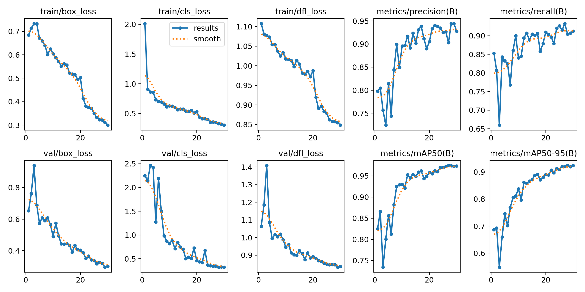
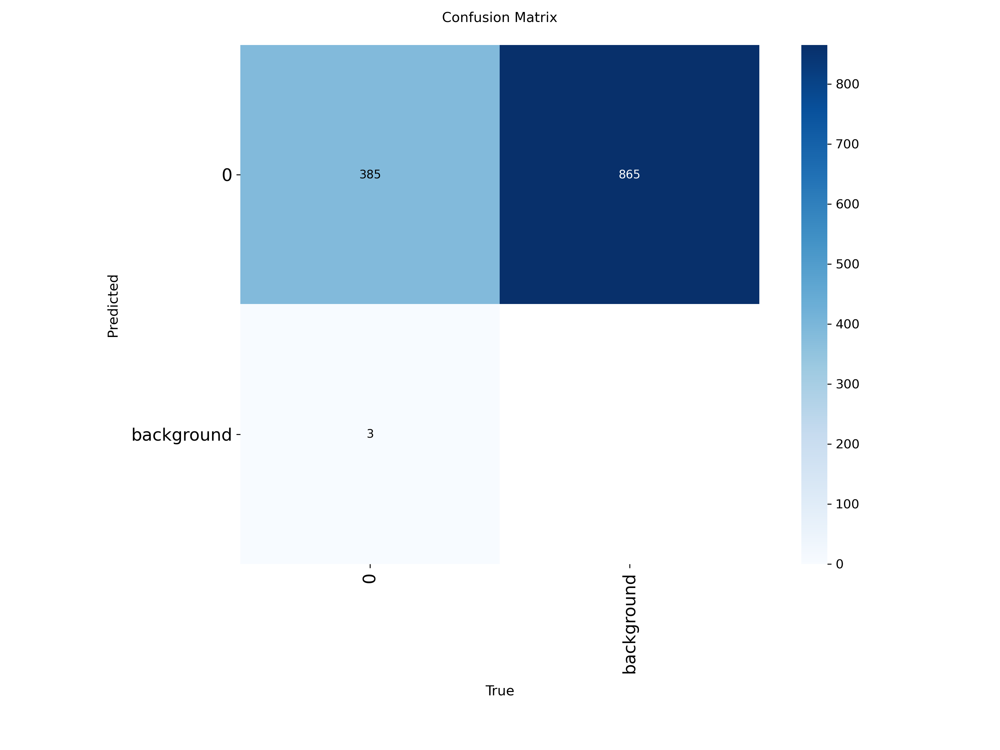

# Portakal Tespiti (YOLO11)

Roboflow'dan alınan bir veri setiyle eğittiğim nesne tespiti modeli.

## Veri seti
- Kaynak: https://universe.roboflow.com/fruit-5mit8/orange-kxh32
- Lisans: CC BY 4.0
- 994 görsel, 1 sınıf (portakal)
- Doğrulama seti: 199 görsel, 388 nesne

## Model ve eğitim
- Model: YOLO11n (Ultralytics)
- 30 epoch, görsel boyutu 640
- Ortam: Google Colab, T4 GPU

## Sonuçlar

| Metrik | Değer |
|---|---|
| Precision | 0.93 |
| Recall | 0.91 |
| mAP50 | 0.97 |
| mAP50-95 | 0.92 |

## Sınırlamalar
- Veri setindeki görseller çoğunlukla net ve sade arka planlı, gerçek ortamda sonuçlar daha düşük olabilir.
- Üst üste duran portakallarda ve yarım dilimlerde güven skorları düşüyor.
- Doğrulama setinde eğitim setine çok benzeyen görseller olabilir, sonuçlar bu yüzden iyimser olabilir.

## Dosyalar
- `Orange.ipynb`: Eğitim kodu (Google Colab'da açılıp çalıştırılabilir)
- `best.pt`: Eğitilmiş model
