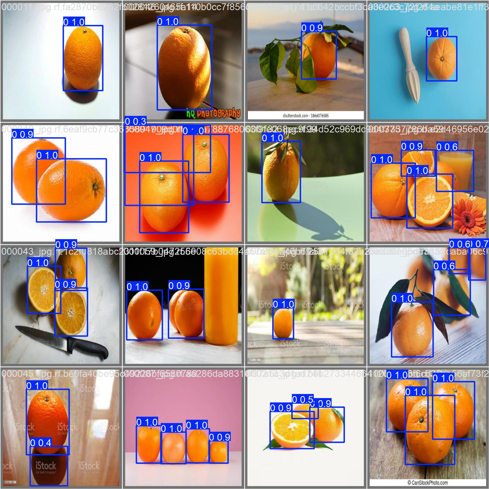

# Portakal Tespiti (YOLO11)

Roboflow'dan alınan bir veri setiyle eğittiğim nesne tespiti modeli.

## Veri seti
- Kaynak: https://universe.roboflow.com/fruit-5mit8/orange-kxh32
- Lisans: CC BY 4.0
- 994 görsel, 1 sınıf (portakal)
- Doğrulama seti: 199 görsel, 388 nesne

## Model ve eğitim
- Model: YOLO11n (Ultralytics)
- 30 epoch, görsel boyutu 640
- Ortam: Google Colab, T4 GPU

## Sonuçlar

| Metrik | Değer |
|---|---|
| Precision | 0.93 |
| Recall | 0.91 |
| mAP50 | 0.97 |
| mAP50-95 | 0.92 |

## Sınırlamalar
- Veri setindeki görseller çoğunlukla net ve sade arka planlı, gerçek ortamda sonuçlar daha düşük olabilir.
- Üst üste duran portakallarda ve yarım dilimlerde güven skorları düşüyor.
- Doğrulama setinde eğitim setine çok benzeyen görseller olabilir, sonuçlar bu yüzden iyimser olabilir.

## Dosyalar
- `Orange.ipynb`: Eğitim kodu (Google Colab'da açılıp çalıştırılabilir)
- `best.pt`: Eğitilmiş model

## Test Seti Sonuçları (Unseen Data)

Modelin eğitim sürecinde hiç görmediği **Test** veri seti üzerindeki performans metrikleri:

| Metrik | Değer |
| :--- | :--- |
| **Precision** | 0.91 |
| **Recall** | 0.89 |
| **mAP50** | 0.94 |
| **mAP50-95** | 0.88 |

### Test Görseli Örnekleri

